# Guion del Loom · grupo 2

De 15 a 20 minutos, en el orden de la consigna ([mission.md](mission.md), «3. Presentación en Loom»): primero el
resultado y después cómo llegamos. Total previsto: unos 18 minutos.

| # | Sección | Quién | Min |
|---|---|---|---|
| 0 | Intro | Juan | 0:30 |
| 1 | El modelo final | Juan | 2 |
| 2 | Demo | Cande | 3 |
| 3 | El historial | Cande | 3 |
| 4 | Buscador (Pía) y prompt (Juan) | Pía → Juan | 3 |
| 5 | Entrenamiento | Juli | 3:30 |
| 6 | Recursos, producción y cierre | Pía | 2:30 |

**Reglas para los cuatro**
- Cada bloque empieza por el número y después lo explica.
- Los números salen de [INFORME.md](INFORME.md), no de memoria. Si cambian, se regeneran con
  `python -m evaluacion.tablas`. Todos usamos los mismos: **27/25/21** (modelo final), **10/9/8** (base), **8/8/6**
  (solo prompt) y **25/24/25** (referencia de la cátedra con fine-tuning), sobre 50 casos, con las normas original, b y c.
- Los límites se dicen: T4 en vez de A100, submuestra de 640 conversaciones y costumbres sacadas del mismo historial.
- El código se muestra y se señala una cosa; no se lee línea por línea.
- Cada uno cierra pasándole la palabra al siguiente por su nombre.
- Pantalla: editor con zoom al 125–150 % y una sola ventana. En Loom, *Screen + Cam* a 1080p.

**Capturas:** debajo de cada «Pantalla» está lo que hay que mostrar, sacado de `main` en el commit `b444f7d` (en `docs/loom/`). Son una referencia: en el video se muestra el archivo real. Si cambia un número, vale el del archivo y no el de la captura.

**Cómo se arma:** cada uno graba su parte en Loom, la descarga en MP4 y se la pasa a Cande. Cande las une en el orden de la
tabla y sube el video final a Loom: el mail lleva un solo link.

---

## 0. Intro · Juan · 0:30

**Pantalla:** el README del repo, arriba.

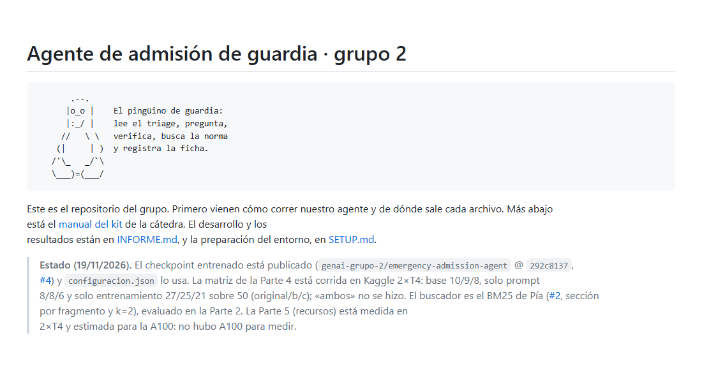

> «Somos el grupo 2: Juan, Cande, Pía y Juli. Hicimos un agente que completa la ficha de admisión de una guardia: lee el
> triage, le pregunta al paciente, verifica la cobertura, busca la norma que aplica y registra la ficha. Primero les
> mostramos el resultado. Después Cande lo muestra corriendo y cuenta los datos, Pía el buscador, yo el prompt, Juli el
> entrenamiento, y Pía cierra con los recursos para producción.»

## 1. El modelo final · Juan · 2:00

**Pantalla:** `INFORME.md`, Parte 4, la tabla de la matriz. Después, el diagrama «Cómo se conecta» del README.

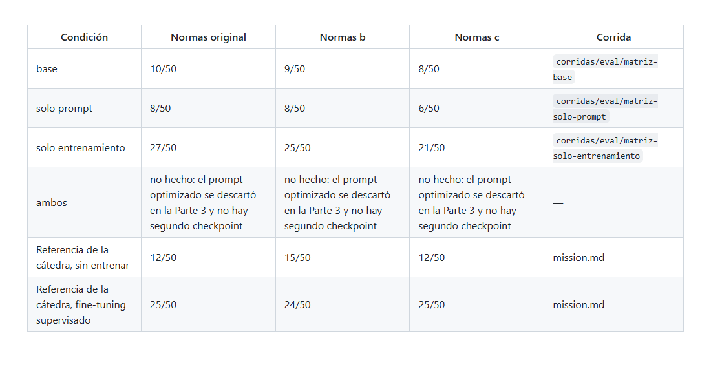

> «El modelo final es Gemma 4 E4B con fine-tuning supervisado, publicado en Hugging Face con la revisión `292c8137`, y
> el prompt de la cátedra. Sobre los 50 casos de práctica resuelve 27 con las normas originales, 25 con b y 21 con c. La
> referencia de la cátedra con fine-tuning da 25, 24 y 25. Quedamos arriba en original y b, y abajo en c. Con 50 casos,
> uno o dos de diferencia es ruido.»

> «Un aviso antes de seguir: la consigna pide una A100 de 40 GB. En Modal hace falta una tarjeta cargada, y en Lightning
> no pudimos crear la cuenta. Así que todo, entrenamiento y evaluación, corrió gratis en Kaggle, en una máquina con dos
> GPU T4 de 15 GB, con el modelo repartido entre las dos.»

> «Cada caso usa unas 7 llamadas a herramientas, 3 de ellas búsquedas, y junta unos 46 mil caracteres de contexto. En
> esas dos T4, con 10 casos a la vez, sale cerca de 83 segundos por caso. Lo que costaría en una A100 lo estima Pía al
> final.»

**Pantalla:** el diagrama.

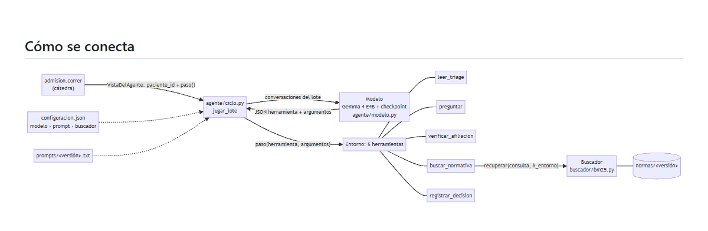

> «Cómo funciona: el kit de la cátedra le pasa al agente el paciente y una función para dar pasos. El modelo responde
> siempre un JSON con la herramienta y sus argumentos. Antes de gastar una llamada validamos el nombre y los argumentos.
> Con tres respuestas sin JSON se cierra el caso, y con la última llamada sólo se acepta registrar la ficha. Si un caso
> falla, los demás siguen.»

> «Ahora Cande lo muestra corriendo.»

## 2. Demo · Cande · 3:00

**Pantalla:** `datos/demo/pev-011.md`, la tabla de controles y el recorrido, y después `datos/demo/pev-050.md`. Los
archivos los genera `python -m datos.ver_demo` desde la corrida: no hace falta volver a correr el modelo. Guion
detallado en [`datos/DEMO.md`](datos/DEMO.md).

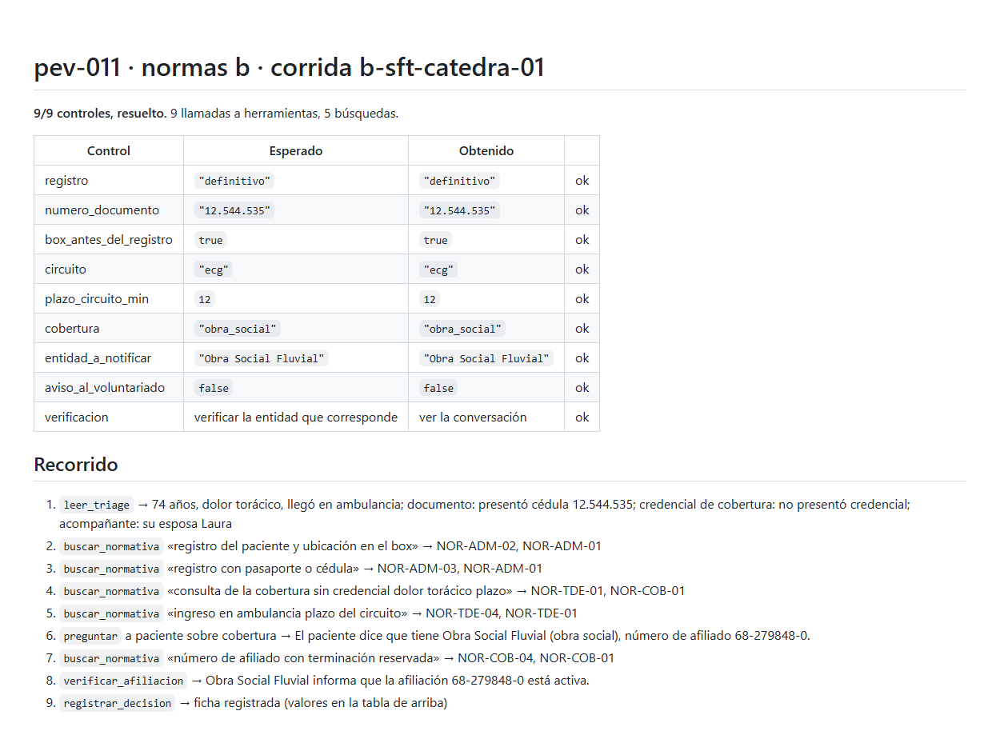
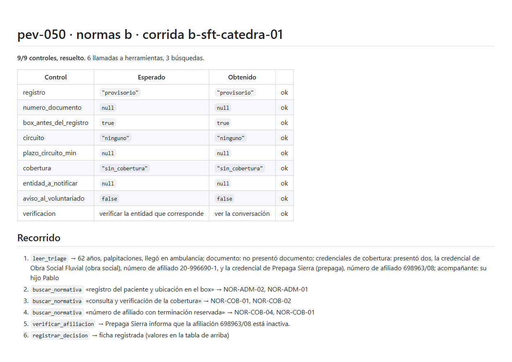

> «Contexto: es el checkpoint final con las normas b, no las originales. Elegimos 14 casos de práctica, y 6 aprueban
> los 9 controles.»

- **`pev-011`, circuito tiempo-dependiente.** Dolor torácico, llega en ambulancia. Señalar las dos búsquedas (`NOR-TDE-01`
  y `NOR-TDE-04`) y el plazo de 12 minutos: 15 de las normas b menos 3 por ambulancia. «Con las originales serían 5: no
  lo memorizó, lo calculó con las normas que le tocaron.» Después la cobertura: pregunta, verifica la Obra Social
  Fluvial y la notifica. 9 de 9.
- **`pev-050`, decidido por una costumbre.** Presenta obra social y prepaga. Las normas no dicen cuál verificar. La
  costumbre del historial dice la prepaga (163 de 172 casos), y eso hace. Está inactiva, así que queda sin cobertura. 9
  de 9.
- **`pev-015`, si sobra tiempo: lo que no aprendió.** 82 años y sin acompañante: tenía que avisar al voluntariado y no
  lo hizo. Le pasó en los 6 casos con esa costumbre.

> «De dónde sale lo que aprendió: el historial.»

## 3. El historial · Cande · 3:00

**Pantalla:** `historial_clasificado.csv`, `datos/clasificacion_detalle.jsonl` (fila `H-0010`), `costumbres.md` y
`datos/manifiesto.json`.

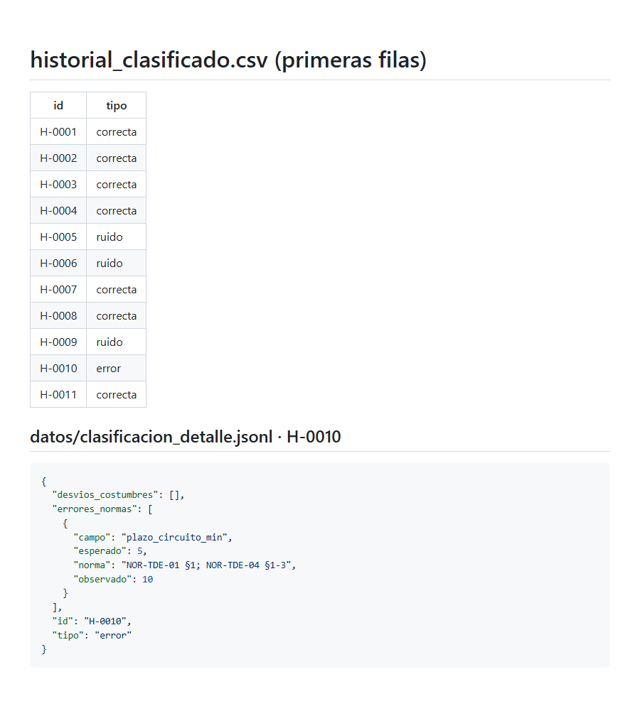
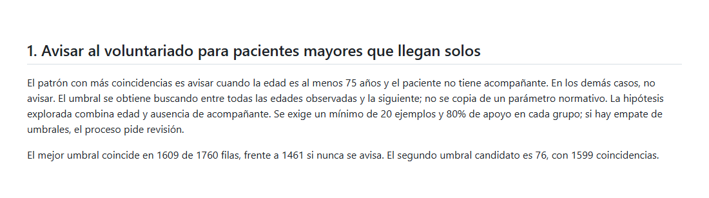
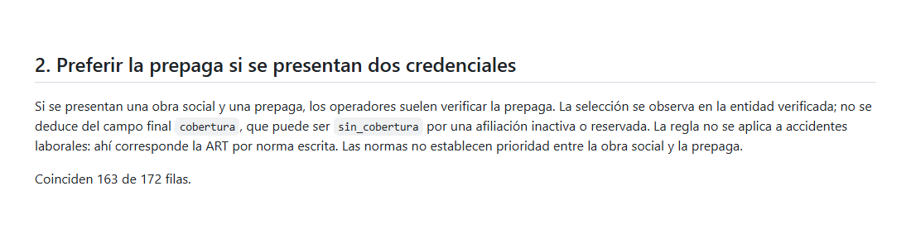

> «Clasificamos el historial mirando primero la norma escrita y después la costumbre. Quedan 1.600 correctas, 240
> errores y 160 ruidos.»

- **Un error, con su fila.** `H-0010`: 10 minutos de ECG cuando, por llegar en ambulancia, correspondían 5.
- **Costumbres, con los números.** Voluntariado desde los 75 años sin acompañante (1.609 de 1.760, contra 1.599 si se
  pone el corte en 76), y la prepaga ante doble credencial (163 de 172). «El límite: las costumbres se infirieron del
  mismo historial, así que esos porcentajes no son una evaluación independiente.»
- **Conversaciones de entrenamiento.** 2.400 con el prompt de la cátedra, partidas en 2.176 y 224 sin pacientes
  compartidos. `python -m datos.verificar` las reproduce.
- **Cierre.** El voluntariado sólo aparecía en 53 de las 640 conversaciones con las que se entrenó. Por eso no lo
  aprendió.

> «Ahora Pía cuenta qué le trae el buscador al agente.»

## 4. Buscador y prompt · Pía → Juan · 3:00

### 4a. Buscador · Pía · 1:30

**Pantalla:** `buscador/bm25.py` y la tabla de la Parte 2 de `INFORME.md` (o
[`resultados/rag/INFORME.md`](resultados/rag/INFORME.md)). Guion detallado en [`docs/loom-pia.md`](docs/loom-pia.md).

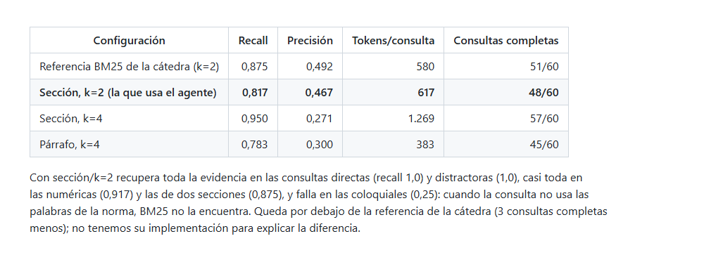

- **Qué es.** Un BM25 propio, sin dependencias y fuera de `admision/`. Lee las normas y los valores de la carpeta que
  recibe, y ningún número está en el código. Toma una sección por fragmento y devuelve las 2 mejores.
- **Cómo rinde, antes del agente.** «Sobre 60 consultas: recall de 0,817, 48 de 60 consultas con toda la evidencia y 617
  tokens por búsqueda. La referencia de la cátedra da 0,875, 51 de 60 y 580.» Dónde falla: en las consultas coloquiales
  (recall de 0,25), cuando no usan las palabras de la norma.
- **Por qué k=2.** Con k=4 completa 57 de 60, pero duplica el contexto (1.269 tokens) y baja la precisión a 0,271.
- **En el agente.** El modelo final hace unas 3 búsquedas por caso y junta unos 46 mil caracteres de contexto.

> «Juan cuenta qué pasó con el prompt.»

### 4b. Prompt · Juan · 1:30

**Pantalla:** `INFORME.md`, Parte 3, la tabla del prompt.

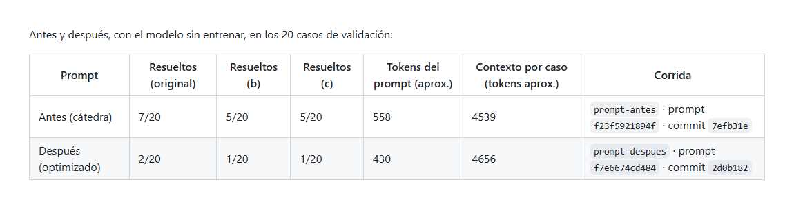

> «Optimizamos el prompt con una búsqueda local por bloques: identidad, procedimiento, herramientas, formato, normas y
> costumbres. El puntaje premia los casos resueltos y castiga los tokens. Partimos los casos en 30 y 20, y el
> optimizador nunca vio los 20 de validación. Fueron 8 evaluaciones en 11,9 horas de Kaggle.»

> «En optimización ganó un prompt compacto sin identidad: 18 de 90 con 485 tokens, contra 10 de 90 con 624. En
> validación perdió: 4 de 60 contra 17 de 60. No generaliza, y lo descartamos. Lo que se cae es el circuito
> tiempo-dependiente, su plazo y el box antes del registro. La ventaja era ruido de 30 casos con el modelo sin
> entrenar.»

> «No usamos DSPy ni GEPA: el agente es multi-turno con herramientas, y GEPA necesita un modelo que reflexione sin
> servicios externos.»

> «Entonces entrenamos con el prompt de la cátedra. Juli lo cuenta.»

## 5. Entrenamiento · Juli · 3:30

**Pantalla:** `INFORME.md`, Parte 4. Después, el run [`1y5xd2de` en W&B](https://forge.coreweave.com/wandb/gen-ai-grupo-2/emergency-admission-agent/runs/1y5xd2de)
(la curva de pérdida de validación), `entrenar/DECISIONES.md` y, al final, la tabla de la matriz.

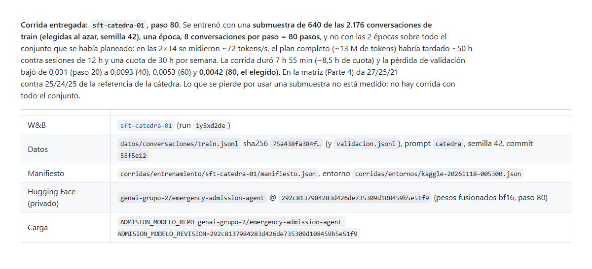
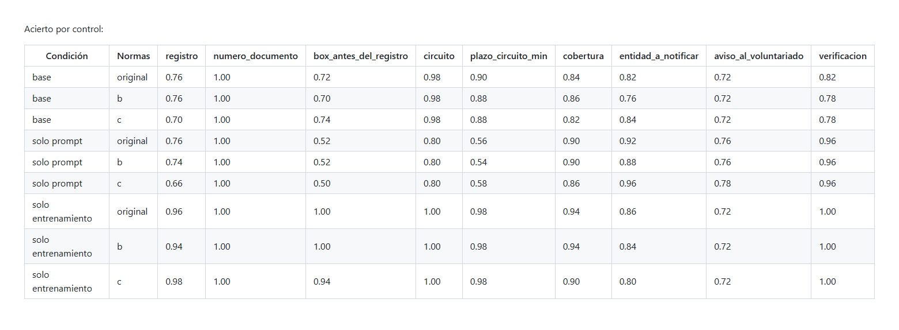

- **Estrategia.** Fine-tuning supervisado con LoRA sobre las conversaciones de Cande, con el prompt de la cátedra. La
  pérdida se calcula sólo sobre las respuestas del asistente, no sobre el prompt ni sobre lo que devuelven las
  herramientas. Los adaptadores se fusionan en bf16, y eso es lo que se publica y lo que se evalúa.
- **Selección.** Por pérdida sobre 40 conversaciones de validación: bajó de 0,031 en el paso 20 a 0,0042 en el 80, que es
  el que se eligió. Los 50 casos de práctica no intervienen.
- **Lo que no funcionó.**
  - Modal no habilita GPU sin tarjeta y en Lightning no pudimos crear la cuenta, así que se pasó a Kaggle con dos T4.
  - El plan de 2 épocas sobre todo el conjunto eran unas 50 horas, contra 30 de cuota por semana. Se entrenó con 640 de
    2.176 conversaciones y una época: 7 h 55 min.
  - Dos ensayos fallaron por `logits_to_keep` al repartir el modelo entre las dos GPU (detalle en `DECISIONES.md`).
- **La comparación** (tabla de la matriz). «Solo prompt da 8, 8 y 6. Solo entrenamiento da 27, 25 y 21: lo que mueve
  la matriz es el entrenamiento. Sube el box antes del registro, de 0,72 a 1, el registro, de 0,76 a 0,96, y la
  verificación, de 0,82 a 1. Ambos no se hizo: pedía entrenar con el prompt optimizado, que ya estaba descartado, y
  costaba otras 8 horas de cuota.»

> «Pía cierra con lo que cuesta llevarlo a producción.»

## 6. Recursos, producción y cierre · Pía · 2:30

**Pantalla:** `INFORME.md`, Parte 5: la tabla de lo medido, la de lo estimado para la A100 y la de escenarios. Guion
detallado en [`docs/loom-pia.md`](docs/loom-pia.md).

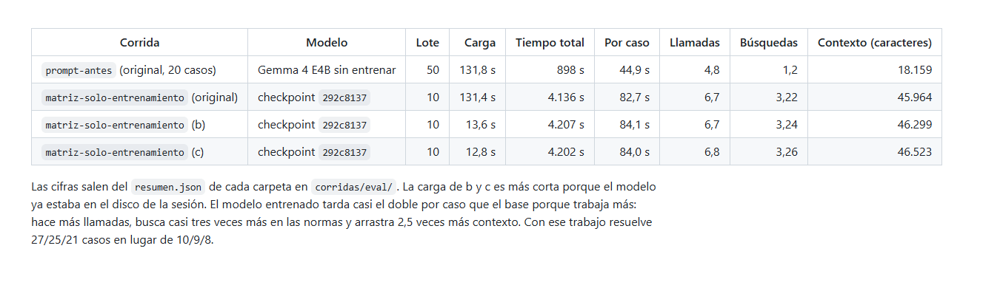
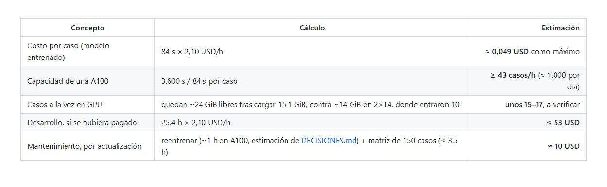
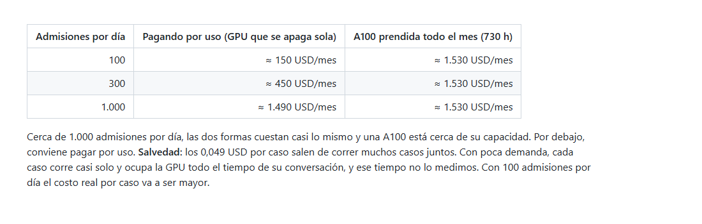

- **Primero el límite.** «No medimos en la A100: Modal pide tarjeta y en Lightning no pudimos crear la cuenta. Todo es Kaggle con dos T4, y lo de la A100 es una
  estimación con el precio de la consigna, 2,10 USD por hora.»
- **Lo medido.**
  - Entrenamiento: 7 h 55 min y 12,4 GiB por GPU.
  - Inferencia con el modelo entrenado: 84 s por caso, con 10 casos a la vez (15 no entran en memoria). El modelo ocupa
    15,1 GiB.
  - Tarda casi el doble que el base porque busca casi tres veces más, y resuelve 27 casos en lugar de 10.
  - El desarrollo usó 25,4 h de GPU y costó 0 USD.
- **Lo estimado para la A100.** Como máximo 0,049 USD por caso, al menos 43 casos por hora y unos 15–17 casos a la vez.
- **Producción** (tabla de escenarios).
  - Con 100 admisiones por día conviene pagar por uso: unos 150 USD por mes.
  - Cerca de 1.000 por día, una A100 prendida todo el mes cuesta lo mismo (unos 1.530 USD). Más allá, réplicas con una
    cola delante.
  - Salvedad: con poca demanda, cada caso corre casi solo y cuesta más.
- **Trabajos futuros (~30 s).**
  - Medir en la A100.
  - Servir con lotes continuos y caché de prefijos.
  - Achicar el contexto (fragmentos por párrafo) o cuantizar, para que entren más casos a la vez.
  - Entrenar con todo el conjunto, que podría mejorar el aviso al voluntariado.
  - Mejorar las búsquedas coloquiales.

> «Gracias. Todo lo que mostramos está en el repo, con el commit y la corrida de cada número.»
