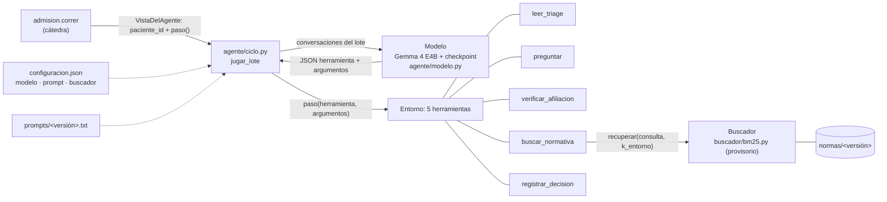

# Agente de admisión de guardia · grupo 2

```text
       .--.
      |o_o |    El pingüino de guardia:
      |:_/ |    lee el triage, pregunta,
     //   \ \   verifica, busca la norma
    (|     | )  y registra la ficha.
   /'\_   _/`\
   \___)=(___/
```

Este es el repositorio del grupo. Primero vienen cómo correr nuestro agente y de dónde sale cada archivo. Más abajo
está el [manual del kit](#kit-del-tp-final-la-ficha-de-admisión-de-guardia) de la cátedra. El desarrollo y los
resultados están en [INFORME.md](INFORME.md), y la preparación del entorno, en [SETUP.md](SETUP.md).

> **Estado (5/11/2026).** El agente, la optimización del prompt y la evaluación están implementados y probados sin GPU.
> Todavía no hay corridas con el modelo real, así que las tablas del informe dicen «pendiente de correr». El buscador es
> provisorio hasta el de Pía (#2), y el checkpoint entrenado lo publica Juli (#4).

## Cómo se conecta



`entrega.py` es lo único que llama la cátedra:
- `construir_buscador(ruta_normas)` arma el buscador con las normas que recibe.
- `construir_agente()` carga el modelo una vez y devuelve el agente.

Qué modelo, qué revisión, qué prompt y qué `k_entorno` se usan sale de [configuracion.json](configuracion.json). Para
evaluar otras condiciones sin editarlo, se puede pisar con las variables `ADMISION_PROMPT`, `ADMISION_MODELO_REPO`,
`ADMISION_MODELO_REVISION` y `ADMISION_BACKEND` (ver `agente/config.py`). `ADMISION_BACKEND=falso` usa un modelo de
juguete para probar sin GPU. **No sirve para reportar números.**

## Correr

Todos los comandos se corren desde la raíz. En Windows, primero `$env:PYTHONUTF8 = '1'`. El modelo necesita GPU. En la
A100 de 40 GB de Modal, cualquier comando de abajo se corre con
`modal run modal_app.py --comando "<módulo> <argumentos>"`, que trae las corridas a `corridas/`. Para eso hace falta un
secreto de Modal llamado `huggingface` con `HF_TOKEN`.

**Un caso.** Juega un caso de práctica con las normas b y lo puntúa:

```bash
uv run python -m evaluacion.evaluar --etiqueta demo-pev-001 --ids pev-001 --normas b
uv run python -m evaluacion.ver --corrida demo-pev-001 --norma b --caso pev-001
```

Se ven la conversación completa (cada llamada a herramienta y lo que devolvió, incluidas las secciones de las normas que
trajo `buscar_normativa`), la ficha registrada y los 9 controles. La corrida queda en `corridas/eval/demo-pev-001/`.

**El buscador:**

```bash
uv run python -m admision.evaluar_rag --entrega entrega.py --normas normas/original --consultas rag/consultas_dev.jsonl
```

**La evaluación completa, sin reentrenar.** Corre los 50 casos con las normas original, b y c y arma la tabla del
informe:

```bash
uv run python -m evaluacion.matriz --correr          # las condiciones que ya tienen prompt y checkpoint
uv run python -m evaluacion.tablas                   # reescribe las tablas de INFORME.md desde corridas/
```

`evaluacion.evaluar` juega cada versión de las normas en un proceso propio, con una carpeta que sólo tiene los casos y
las normas, y puntúa después, en otro proceso. Así el agente nunca ve las fichas esperadas.

**El prompt** (Parte 3, con el modelo sin entrenar):

```bash
uv run python -m optimizacion.particion --semilla 42 --validacion 20          # regenera optimizacion/particion.json
uv run python -m optimizacion.optimizar --nombre busqueda-01                  # búsqueda; nunca usa validación ni test
uv run python -m optimizacion.congelar --corrida busqueda-01                  # prompts/optimizado.txt + .json
uv run python -m evaluacion.evaluar --etiqueta prompt-antes   --prompt catedra    --casos validacion
uv run python -m evaluacion.evaluar --etiqueta prompt-despues --prompt optimizado --casos validacion
uv run python -m optimizacion.comparar
```

**Pruebas** (sin GPU):

```bash
uv run python -m unittest discover -s tests -p "test_agente_*.py" -v
```

## De dónde sale cada archivo

| Archivo | Lo genera | Semilla / configuración |
|---|---|---|
| `prompts/catedra.txt` | `mensaje_de_sistema()` de `admision/ejemplo.py`. Es igual al prompt que usa `datos.preparar` | — |
| `prompts/optimizado.txt` y `.json` | `python -m optimizacion.congelar --corrida <nombre>` | la de la corrida |
| `optimizacion/particion.json` | `python -m optimizacion.particion` | semilla 42, 20 casos de validación |
| `corridas/prompt/<nombre>/` | `python -m optimizacion.optimizar` | `corrida.json`: commit, `uv.lock`, modelo, λ, partición |
| `corridas/eval/<etiqueta>/` | `python -m evaluacion.evaluar` o `evaluacion.matriz` | `condicion.json`: prompt, checkpoint, commit, comandos |
| Tablas de `INFORME.md` | `python -m evaluacion.tablas` | sólo lee `corridas/` |
| `historial_clasificado.csv`, `costumbres.md` y conversaciones | `datos/` de Cande (#1, rama `cande/datos-historial`) | ver `datos/README.md` |
| Checkpoints y corridas de W&B | entrenamiento de Juli (#4) | pendiente |

## Loom: sección de Juan (agente y prompt, unos 4 minutos)

1. **El agente.** El diagrama de arriba, el protocolo JSON y qué pasa con el JSON inválido, una herramienta que no
   existe y el tope de 40 llamadas (con las pruebas de `tests/test_agente_ciclo.py`).
2. **El prompt.** La búsqueda por bloques y la partición 30/20 por caso. La tabla antes/después muestra los casos
   resueltos y los tokens, y los candidatos descartados están en `corridas/prompt/`.
3. **La matriz.** Base, solo prompt, solo entrenamiento y ambos, contra la referencia de la cátedra (12/15/12 y
   25/24/25), con las regresiones por control.

## Checklist final de la entrega (con el grupo)

- [ ] `prompts/optimizado.txt` congelado y entregado a Cande y Juli antes del entrenamiento.
- [ ] `configuracion.json` apunta al checkpoint final de Hugging Face con su revisión exacta.
- [ ] Dependencias de inferencia fijadas en `pyproject.toml`/`uv.lock` (hoy sólo están en la imagen de `modal_app.py`).
- [ ] Las 12 evaluaciones de la matriz corridas y `python -m evaluacion.tablas` sin «pendiente».
- [ ] Secciones de los cuatro integradas en `INFORME.md`.
- [ ] Repositorio, Hugging Face y W&B compartidos con la cátedra, y el commit entregado anotado en el mail.
- [ ] Loom de 15 a 20 minutos con la demo en normas b o c.

---

# Kit del TP final: la ficha de admisión de guardia

El enunciado (qué hay que hacer, qué se entrega y cómo se corrige) está en [mission.md](mission.md), y el video que lo presenta en dos partes: [Parte 1](https://www.loom.com/share/2c56572757124aaf8e2a1e1398efe27d) y [Parte 2](https://www.loom.com/share/12f6cb81c76440cd8a86563dcc02b2f2). Esto explica qué trae el kit y cómo se usa.

La preparación del entorno del grupo está en [SETUP.md](SETUP.md).

## Qué trae

| Carpeta | Contenido |
|---|---|
| `normas/original/` | 20 secciones de las normas del hospital, una por archivo, y `parametros.yaml` con los valores |
| `normas/b/`, `normas/c/` | Las mismas normas con otros números, como hará el test de la cátedra |
| `practica/` | 50 casos de práctica (`casos.jsonl`) y la ficha esperada de cada uno con cada versión de las normas (`esperadas-<versión>.jsonl`) |
| `historial/` | 2.000 admisiones pasadas, sin marcar (`historial.csv`), y los pasos de cada una, en orden (`trazas.jsonl`) |
| `entrenamiento/trazas.jsonl` | Las 800 trazas con las que la cátedra entrenó su modelo de referencia, en el mismo formato |
| `rag/consultas_dev.jsonl` | Consultas con la evidencia esperada, para evaluar el buscador |
| `admision/` | El entorno, el comparador, el generador de casos, el agente de ejemplo, el programa que corre los casos y la evaluación del buscador |

Las normas citan a veces disposiciones generales (`NOR-GEN`) que no están entre los archivos. No hacen falta para
completar la ficha.

## Instalarlo

`admision/` es un paquete de Python que usa solo la biblioteca estándar y pyyaml.

- Para trabajar desde esta carpeta: `uv sync`, y los comandos de abajo se corren desde acá.
- Para usarlo desde el repositorio del grupo, agréguenlo a su entorno con la ruta a esta carpeta:
  `uv add <ruta a esta carpeta>` (o `pip install <ruta a esta carpeta>`). Así `import admision` funciona desde su código, y los mismos
  comandos corren desde su repositorio, con las rutas al kit.

No hace falta copiar `admision/` adentro del repositorio. Si lo copian, la cátedra lo reemplaza por su propia copia al
correr la entrega.

## El contrato de la entrega

El repositorio del grupo tiene un archivo de Python, por ejemplo `entrega.py`, con dos funciones:

```python
def construir_buscador(ruta_normas):   # arma el buscador con las normas de esa carpeta
    ...
def construir_agente():                # carga el modelo una sola vez
    ...
```

- **El buscador** tiene `recuperar(consulta, k)`, que devuelve una lista de objetos con atributo `texto` (o strings),
  de más a menos relevante. Si define `k_entorno`, esa es la cantidad que devuelve la herramienta `buscar_normativa`;
  si no, 2. En el test, los números de las normas cambian, así que el buscador se arma siempre con la carpeta que
  recibe (es una copia de las normas en una carpeta aparte). Si el buscador falla en una búsqueda, esa llamada vuelve
  como error (`Error: el buscador falló: <tipo de error>.`) y el caso sigue.
- **El agente** tiene `jugar_lote(entornos)`. Cada elemento de `entornos` es un caso, y tiene solo dos cosas: el id
  del paciente (`paciente_id`) y `paso(herramienta, argumentos)`, que devuelve la observación y si el caso terminó. El
  agente juega cada caso llamando a `paso` hasta `registrar_decision` y devuelve, por caso, la conversación completa
  con el modelo: cada mensaje que entró y cada uno que salió, en el mismo orden que `entornos`.
- **Tope de llamadas:** cada caso admite hasta 40 llamadas a herramientas. Si llega a 40 sin registrar la ficha, el
  caso termina sin ficha. Una llamada a un caso terminado devuelve `El caso ya terminó.` y no cuenta.
- **Fijos:** los nombres y argumentos de las cinco herramientas y los 8 campos de la ficha (ver
  `admision/ejemplo.py`). `registrar_decision` acepta además `fundamentos`, la lista de secciones de las normas que
  justifican la ficha: es optativo y no se corrige.
- **Libres:** el mensaje de sistema, el formato de los mensajes al modelo, la cantidad de búsquedas y la estrategia.
- En operación, el agente no llama a ningún servicio externo.

`admision/ejemplo.py` es el agente de la referencia de la cátedra, con su mensaje de sistema. Pueden usarlo o
reemplazarlo entero.

## Correr la práctica

```bash
uv run python -m admision.correr practica --entrega entrega.py --casos practica/casos.jsonl \
    --esperadas practica/esperadas-original.jsonl --normas normas/original --salida corridas/original
```

Trabaja en dos fases, que también se pueden correr por separado:

1. **Jugar** (`python -m admision.correr jugar --entrega ... --casos ... --normas ... --salida ...`): arma el buscador
   y el agente y juega los casos, sin mirar las fichas esperadas. Deja en `--salida` las trazas (`trazas.jsonl`: por
   caso, la conversación completa, cada llamada a herramienta con lo que devolvió, y la ficha) y los tiempos
   (`tiempos.json`).
2. **Puntuar** (`python -m admision.correr puntuar --trazas .../trazas.jsonl --esperadas ... --salida ...`): compara
   cada ficha con la esperada. Deja el resultado caso por caso (`resultados.jsonl`) y el resumen (`resumen.json`).

`jugar` no arranca si encuentra un archivo `esperadas-*.jsonl` en la carpeta desde la que se corre, en la de los casos,
en la de las normas o en alguna de las tres carpetas de arriba de la de las normas. Como `practica/` tiene los casos y
las esperadas juntos, para correr `jugar` solo, copien `practica/casos.jsonl` a otra carpeta. `practica` lo hace por su
cuenta: copia los casos y las normas a una carpeta temporal y juega ahí.

Un caso está resuelto si pasan los 9 controles: los 8 campos de la ficha y la verificación de la afiliación. Es el
formato que se exige para cada número que se reporta.

**Tiempos y contexto.** El tiempo lo mide `admision.correr`, no el agente: cuánto tarda `construir_agente`, cuánto
tarda `jugar_lote` entero y, por caso, en qué segundo hizo su última llamada (los casos de un lote corren a la vez).
Los caracteres de contexto (lo que se le pasó al modelo en todo el caso) salen de la conversación que devuelve el
agente, así que esa conversación tiene que ser completa.

Si `jugar_lote` se cae a mitad de camino, las trazas igual se escriben con lo que llegó a pasar en cada caso, y el
error queda anotado en `tiempos.json` y en el resumen.

## Cómo corre la cátedra su entrega

- Cada entrega corre en un proceso propio, en una GPU A100 de 40 GB (no la de 80 GB), sin tiempo máximo.
- La cátedra instala las dependencias fijadas en el repositorio del grupo y su propia copia de `admision` (si el
  repositorio trae una, la reemplaza).
- El modelo se baja del repositorio de Hugging Face del grupo. Por eso `construir_agente()` lee el id del repositorio
  y la revisión (el commit o la etiqueta exacta del modelo) desde el código o la configuración del grupo. La cátedra
  pone en el entorno `HF_TOKEN`, la clave que le da acceso a ese repositorio privado.
- Las dos fases corren por separado: primero `jugar`, en una máquina que tiene solo los casos y las normas del test
  secreto, y después `puntuar`, en otra, con las fichas esperadas. El agente nunca ve las fichas esperadas.

## Evaluar el buscador

```bash
uv run python -m admision.evaluar_rag --entrega entrega.py --normas normas/original --consultas rag/consultas_dev.jsonl
```

Mide si el buscador trae la evidencia (recall), qué parte de lo que trae sirve (precisión) y cuántos tokens trae, con lo
que el buscador devuelve en el entorno (`k_entorno`) y con presupuestos fijos de 256, 512 y 1024 tokens. Es una
evaluación obligatoria antes de empezar el agente, y se documenta. No es la nota: el buscador cuenta por lo que rinde
el agente con él.

## Generar casos

```python
from admision.generador import generar
casos = generar(semilla=42, n=1000)
```

Son casos sin la respuesta. La ficha correcta hay que deducirla de las normas y del historial.

## El historial

Una fila por admisión pasada, como la exportación del sistema de admisión:

- **Identificación:** id de la fila, fecha y operador.
- **Lo que decía el triage:** edad, nivel, motivo, nota de enfermería, sospecha de sepsis, llegada, documento,
  credenciales, si podía responder, acompañante y si se lesionó trabajando.
- **Lo que averiguó el operador:** cobertura declarada, ART declarada y la entidad y el número que verificó, con la
  respuesta de la entidad.
- **La ficha que completó:** los 8 campos.

No está marcado. Hay filas correctas, errores y ruido, y el hospital tiene costumbres que no están escritas en las
normas.

**Las trazas.** `historial/trazas.jsonl` tiene una línea por fila del historial, en el mismo orden, con los pasos que
siguió el operador: cada llamada a una herramienta, numerada, con sus argumentos y el resultado que devolvió el entorno,
y la ficha que registró.

`entrenamiento/trazas.jsonl` tiene, en el mismo formato, las 800 trazas con las que la cátedra entrenó su modelo de
referencia. Los valores de las normas cambian de una traza a otra.

Para entrenar, cada traza se pasa a una conversación con el formato del agente de ejemplo (`admision/ejemplo.py`):

1. el mensaje de sistema;
2. un mensaje del usuario: `Ingresó a la guardia el paciente <paciente_id>. Completá su ficha de admisión.`;
3. por cada paso, un mensaje del asistente con la llamada en JSON (`{"herramienta": ..., "argumentos": ...}`) y,
   salvo después de `registrar_decision`, un mensaje del usuario con `Resultado de <herramienta>:`, un salto de línea
   y el resultado.

**Qué se entrega de la clasificación:**

- `historial_clasificado.csv`, con dos columnas, `id,tipo`, y una fila por cada fila del historial (las 2.000).
  `tipo` es uno de estos tres valores:
  - `correcta`: la fila sigue las normas escritas y hace lo que hacen casi todos los operadores;
  - `error`: la fila viola una norma escrita;
  - `ruido`: la fila hace algo que las normas no cubren, distinto de lo que hacen casi todos los operadores en esa
    situación (o sea, se aparta de una costumbre).
- `costumbres.md`, en texto libre: cada costumbre que descubrieron, explicada, con los ids de las filas que la
  respaldan.
