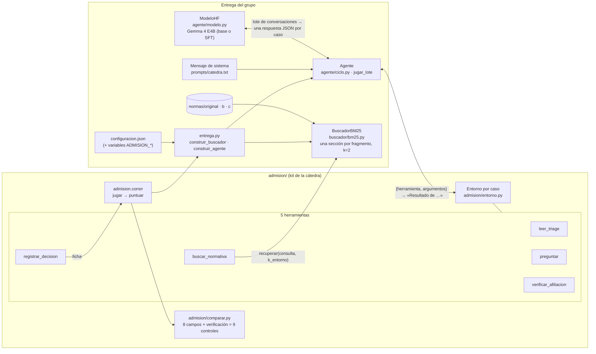

# Arquitectura: modelo, agente, herramientas y buscador

Cómo se conectan las piezas cuando se juega un caso. Lo que está en `admision/` es el kit de la cátedra y no se
modifica. El resto es del grupo.

## Un caso, paso a paso

1. `admision.correr` arma un `Entorno` por caso y le pasa a la entrega sólo el id del paciente y una función
   `paso(herramienta, argumentos)`. El agente nunca ve el caso ni las fichas esperadas.
2. `entrega.py` lee `configuracion.json`: modelo y revisión, prompt, parámetros del buscador y límites del agente.
   Cualquiera se puede pisar con variables `ADMISION_*` (`agente/config.py`). Así se evalúa cada condición de la
   matriz sin tocar el código.
3. En cada vuelta, el `Agente` llama una vez al modelo con todas las conversaciones activas. Cada respuesta es un
   objeto `{"herramienta": ..., "argumentos": {...}}`. El entorno la ejecuta y el resultado vuelve como mensaje del
   usuario.
4. `buscar_normativa` llama a `recuperar(consulta, k_entorno)` del buscador del grupo, que devuelve las dos secciones
   de las normas de esa corrida (`original`, `b` o `c`) que más se parecen a la consulta. Por eso los plazos que cambian
   entre versiones se buscan en vez de memorizarse.
5. `registrar_decision` cierra el caso con la ficha. Después, `puntuar` la compara con la esperada y da los 9
   controles: los 8 campos de la ficha y si se verificó la afiliación correcta.

## Límites del agente

Salen de `configuracion.json` (`agente`): como máximo 40 llamadas a herramientas, 3 respuestas seguidas sin JSON válido
y 60 turnos. Cuando quedan 5 llamadas, el agente avisa. Con una sola, sólo acepta `registrar_decision`. Si un caso
falla, se cierra ese caso y el resto del lote sigue.
